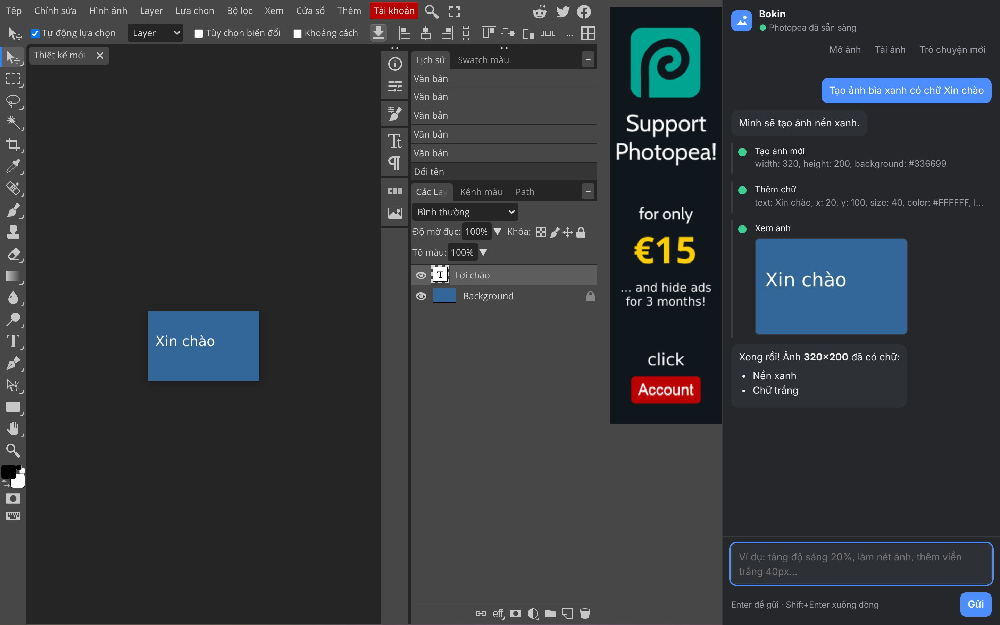

# Bokin – Chỉnh sửa ảnh bằng câu lệnh

Bokin là công cụ web giúp chỉnh sửa ảnh bằng câu lệnh tiếng Việt. Bạn gõ yêu cầu như *"làm ảnh sáng hơn, cắt vuông, thêm chữ GIẢM 50% màu đỏ ở góc trên"*; **Claude** hiểu yêu cầu và điều khiển **[Photopea](https://www.photopea.com)**, một trình chỉnh ảnh giống Photoshop chạy ngay trong trình duyệt, để thực hiện. Bạn vẫn có thể chỉnh tay trực tiếp trong Photopea bất cứ lúc nào.



## Bokin làm được gì

| Nhóm | Ví dụ câu lệnh |
|---|---|
| Ánh sáng & màu | "tăng sáng một chút", "tăng tương phản", "màu tươi hơn", "chỉnh Levels/Curves", "tự động cân màu" |
| Hiệu ứng | "đen trắng", "sepia", "tông ấm/lạnh", "đảo màu", "posterize" |
| Bộ lọc | "làm nét", "làm mờ nền", "giảm nhiễu", "thêm hạt film", "mờ chuyển động" |
| Khung ảnh | "cắt vuông 1:1", "cắt 16:9 giữ người ở giữa", "đổi kích thước 1080px", "xoay 90°", "lật ngang", "thêm viền trắng 40px" |
| Vùng chọn | "làm tối nửa trái", "tô đen vùng này", "xoá vùng góc dưới" |
| Chữ & hình | "thêm chữ *Khai trương* font Montserrat đậm", "đặt chữ ở góc dưới phải", "vẽ thanh nền đen mờ phía sau chữ" |
| Layer | nhân đôi, xoá, đổi tên, đổi thứ tự, độ mờ, chế độ hoà trộn, gộp layer |
| AI tạo ảnh (tuỳ chọn) | "xoá người phía sau", "đổi nền thành bãi biển", "thêm kính râm cho người này", "đổi áo sang màu đỏ" |
| Khác | tạo ảnh mới theo kích thước (bìa Facebook, story…), hoàn tác/làm lại, xuất PNG/JPG/WEBP/PSD |

Claude **tự xem ảnh** (trước và sau khi sửa) để chọn vị trí đặt chữ, kiểm tra độ sáng, rồi tự hoàn tác nếu kết quả chưa ổn.

## Cài đặt và chạy

Cần có **Node.js 22.9 trở lên** và một **API key Claude** (tạo tại [platform.claude.com](https://platform.claude.com)).

1. Cài thư viện:

   ```bash
   npm install
   ```

2. Tạo file cấu hình rồi điền `ANTHROPIC_API_KEY`:

   ```bash
   cp .env.example .env
   ```

3. Chạy server:

   ```bash
   npm start
   ```

4. Mở trình duyệt tại <http://localhost:3000>. Bấm **Mở ảnh** (hoặc kéo thả ảnh vào trang) rồi gõ yêu cầu.

Trong lúc phát triển, dùng `npm run dev` để server tự khởi động lại khi sửa code.

### Cấu hình (`.env`)

| Biến | Mặc định | Ý nghĩa |
|---|---|---|
| `ANTHROPIC_API_KEY` | (bắt buộc) | API key Claude |
| `CLAUDE_MODEL` | `claude-opus-5-5` | Model sử dụng. `claude-sonnet-5-5` rẻ hơn khoảng một nửa. |
| `CLAUDE_EFFORT` | `medium` | Mức suy nghĩ: `low` nhanh/rẻ hơn, `high` cẩn thận hơn |
| `CLAUDE_FALLBACKS` | `default` | Khi một yêu cầu bị bộ lọc an toàn từ chối, API tự chạy lại trên model dự phòng. `off` để tắt. |
| `PORT` / `HOST` | `3000` / `127.0.0.1` | Địa chỉ server. Giữ `127.0.0.1` nếu chưa có đăng nhập, vì server dùng API key của bạn. |
| `HF_TOKEN` | (trống = tắt) | Token Hugging Face để bật chỉnh sửa bằng AI tạo ảnh |
| `AI_EDIT_MODEL` | `Qwen/Qwen-Image-Edit-2511` | Mô hình chỉnh ảnh theo chỉ dẫn |
| `AI_EDIT_PROVIDER` | `auto` | Nhà cung cấp chạy mô hình: `auto`, `fal-ai`, `wavespeed` |

### Bật chỉnh sửa bằng AI tạo ảnh (tuỳ chọn)

Các yêu cầu thay đổi **nội dung** ảnh (xoá vật thể, đổi nền, thêm chi tiết…) dùng mô hình **Qwen-Image-Edit-2511** (giấy phép Apache-2.0, được dùng thương mại), chạy qua [Hugging Face Inference Providers](https://huggingface.co/docs/inference-providers). Mô hình do fal.ai hoặc WaveSpeed chạy, Hugging Face định tuyến.

1. Tạo token tại [huggingface.co/settings/tokens](https://huggingface.co/settings/tokens) với quyền **Make calls to Inference Providers**.
2. Thêm `HF_TOKEN=...` vào `.env` rồi khởi động lại server.

Cách hoạt động: Bokin gửi ảnh (hoặc chỉ vùng cần sửa kèm một phần xung quanh) cho mô hình, rồi đặt kết quả thành **layer mới** phía trên. Ảnh gốc vẫn còn bên dưới; khi sửa theo vùng, Bokin thêm mask để chỉ thay đúng vùng đó. Mỗi lần sửa mất khoảng 10–60 giây và tính phí vào tài khoản Hugging Face (thường vài cent mỗi ảnh; xem bảng giá của nhà cung cấp). Mô hình không tạo được nền trong suốt; muốn tách nền trong suốt thì dùng *Remove BG / Magic Cut* có sẵn trong Photopea.

Khi chưa có `HF_TOKEN`, công cụ này được ẩn khỏi Claude và Claude sẽ nói rõ là tính năng chưa bật.

## Cách hoạt động

```
┌──────────────────── Trình duyệt ─────────────────────┐         ┌──── Server Node.js ────┐        ┌────────────┐
│                                                      │ lịch sử │                        │        │            │
│  Ô chat + vòng lặp tool (public/app.js)  ────────────┼────────▶│  POST /api/chat        │───────▶│ Claude API │
│        │                                 ◀───────────┼─────────│  (giữ API key, gắn      │◀───────│            │
│        │ tool_use                        tool_use    │         │   system prompt + tools)│        └────────────┘
│        ▼                                             │         └────────────────────────┘
│  ToolRunner (public/tool-runner.js)                  │
│        │ script Photopea (giống Photoshop)           │
│        ▼                                             │
│  PhotopeaBridge ──postMessage──▶ Photopea (iframe)   │
└──────────────────────────────────────────────────────┘
```

1. Bạn gõ yêu cầu; trình duyệt gửi lịch sử hội thoại lên server.
2. Server gọi Claude kèm danh sách **28 tool** (định nghĩa trong `shared/tools.js`).
3. Claude trả về các lệnh `tool_use`. Trình duyệt chạy từng lệnh bằng cách gửi **script** vào Photopea qua Live Messaging API (`postMessage`), rồi gửi kết quả (`tool_result`, có thể kèm ảnh xem trước) lên lại.
4. Lặp lại cho tới khi Claude trả lời xong.

Vòng lặp tool chạy **ở trình duyệt** vì Photopea nằm trong trình duyệt của người dùng. Server không lưu trạng thái, chỉ giữ API key.

### Cấu trúc thư mục

```
server/
  index.js          khởi động server
  app.js            Express: phục vụ giao diện, /api/health, /api/chat
  chat.js           gọi Claude API (model, effort, prompt caching, fallback), xử lý lỗi
  ai-edit.js        chỉnh sửa bằng AI tạo ảnh qua Hugging Face (POST /api/ai-edit)
  system-prompt.js  hướng dẫn cho Claude
shared/             dùng chung cho server và trình duyệt
  tools.js          định nghĩa 28 tool + hàm sinh script Photopea cho từng tool
  script-kit.js     hàm phụ trợ sinh script an toàn (thoát chuỗi, kiểm tra cú pháp)
  validate.js       kiểm tra tham số tool theo JSON Schema
public/
  index.html, styles.css, app.js   giao diện chat
  photopea-bridge.js               giao tiếp với Photopea
  tool-runner.js                   chạy tool, xem ảnh, hoàn tác, xuất file
test/
  unit/             kiểm thử nhanh (không cần mạng)
  e2e/              kiểm thử trên Photopea thật bằng Playwright
eval/               đánh giá với Claude API thật (npm run eval)
```

### Thêm một tool mới

Thêm một mục vào mảng `TOOLS` trong `shared/tools.js`:

```js
{
  name: 'ten_tool',                 // tên Claude sẽ gọi
  label: 'Tên hiển thị',            // tiếng Việt, hiện trong ô chat
  kind: 'script',
  description: 'Mô tả cho Claude: tool làm gì và KHI NÀO nên dùng.',
  input_schema: { type: 'object', properties: { ... }, additionalProperties: false },
  build(input) {
    return wrap(`${targetLayer(input.layer, { requirePixels: true })}
layer.applyGaussianBlur(${num(input.radius)});
__ok({ layer: layer.name });`);
  },
},
```

Sau đó thêm ví dụ đầu vào vào `test/unit/tools.test.js` và một kiểm thử đo pixel vào `test/e2e/tools.e2e.test.js`.

### Lưu ý quan trọng về script Photopea

Photopea chạy script bằng **trình thông dịch riêng**, không phải JavaScript của trình duyệt. Các điểm dưới đây đã được kiểm chứng thực tế:

- **Chỉ dùng cú pháp ES5 đơn giản:** `var`, `function`, vòng lặp `for`. Arrow function, template string, `arguments` và callback truyền vào `map`/`forEach`/`filter`/`sort` **không chạy**.
- **Khi script lỗi, `try/catch` không bắt được** và Photopea không gửi tín hiệu `"done"`. Bokin xử lý bằng cách gửi thêm một script "sentinel" sau mỗi lệnh, nên phát hiện lỗi ngay. Script của tool tự kiểm tra điều kiện (có ảnh chưa, layer có tồn tại không…) và báo lỗi bằng `__fail(...)`.
- **Một số hàm DOM không làm gì cả** dù không báo lỗi: `adjustLevels`, `adjustCurves`, `adjustColorBalance`, `applyUnSharpMask`, `applyMedianNoise`, `posterize`, `threshold`, `mergeVisibleLayers`. Bokin dùng **Action Manager** (`app.executeAction`) thay cho các hàm này.
- `resizeImage(w, null)` bị lỗi, nên phải truyền đủ cả hai chiều. Giá trị `bounds` là đối tượng, cần đọc qua `.value`.
- So sánh đối tượng bằng `===` không đáng tin cậy, nên so sánh layer theo tên.
- Chữ được vẽ **bất đồng bộ** (font tải qua mạng), nên ngay sau khi tạo chữ, kích thước có thể bằng 0. Bokin chờ tới khi kích thước ổn định rồi mới báo cho Claude.

## Kiểm thử

```bash
npm test
```

Kiểm thử end-to-end mở Chromium thật, tải Photopea từ internet, chạy từng tool rồi **đo pixel** để chắc chắn ảnh thực sự thay đổi. Kiểm thử này cũng chạy cả vòng lặp chat với một Claude API giả lập, và tool AI với một dịch vụ AI giả lập, nên không tốn tiền. Lần đầu cần cài trình duyệt cho Playwright:

```bash
npx playwright install chromium
```

```bash
npm run test:e2e
```

### Đánh giá với Claude API thật

`npm run eval` chạy 12 câu lệnh tiếng Việt (làm sáng, đen trắng, cắt vuông giữ chủ thể, thêm chữ, đổi màu chữ, hoàn tác, thu nhỏ, thêm viền, làm mờ nền, tạo ảnh bìa, tăng tương phản, xoá vật thể bằng AI) qua **giao diện thật, Photopea thật và Claude API thật** trên một ảnh mẫu. Mỗi tình huống được chấm tự động bằng cách đo pixel và layer, rồi ghi số lượt gọi, token và chi phí ước tính vào `eval/out/<thời gian>/report.md`, kèm ảnh kết quả.

```bash
npm run eval
```

Chạy một phần, ví dụ chỉ các tình huống có "chu" trong tên:

```bash
npm run eval -- chu
```

Lưu ý: lệnh này **tốn tiền API thật**, ước tính 1–3 USD cho toàn bộ với `claude-opus-5-5`. Tình huống xoá vật thể bằng AI chỉ chạy khi có `HF_TOKEN`.

## Chi phí và giới hạn

- Mỗi lượt gửi lại toàn bộ lịch sử hội thoại, kể cả ảnh xem trước (khoảng 1–1,5 nghìn token mỗi ảnh). Prompt caching giúp giảm chi phí phần lặp lại. Khi chuyển sang ảnh khác hoặc việc khác, bấm **Trò chuyện mới** để cuộc trò chuyện gọn và rẻ.
- Hoàn tác/làm lại của Bokin dựa trên lịch sử Photopea. Nếu bạn tự bấm Ctrl+Z trong Photopea, lần hoàn tác tiếp theo của Bokin có thể lệch bước.
- Chỉnh sửa bằng AI trên toàn ảnh lớn: ảnh được thu nhỏ tối đa 1536px trước khi gửi, nên kết quả kém nét hơn ảnh gốc. Với chỉnh sửa cục bộ, Claude chỉ gửi vùng cần sửa, nên phần còn lại giữ nguyên chất lượng.
- Gộp layer vào layer `Background` bị khoá có thể thất bại; khi đó dùng "gộp tất cả" (flatten).

## Điều khoản Photopea

Photopea **không phải mã nguồn mở**, nhưng cho phép nhúng vào website qua iframe và dùng API scripting **miễn phí** ([Photopea API](https://www.photopea.com/api/)). Ở chế độ miễn phí, Photopea hiển thị quảng cáo và thương hiệu của họ (như trong ảnh chụp màn hình ở trên). Nếu làm sản phẩm thương mại:

- **Distributor account**: trả phí theo lượt xem để ẩn quảng cáo/thương hiệu trên tên miền của bạn.
- **Bản tự host**: khoảng 500–2000 USD/tháng (trả theo năm), không phụ thuộc photopea.com.

Chi tiết tại [photopea.com/api/accounts](https://www.photopea.com/api/accounts). Kiến trúc của Bokin tách riêng lớp điều khiển (`shared/tools.js`, `public/tool-runner.js`) khỏi Photopea (`public/photopea-bridge.js`), nên có thể thay Photopea bằng trình chỉnh ảnh khác (ví dụ miniPaint, giấy phép MIT) mà không phải viết lại phần AI.

## Hướng phát triển

- Thêm nhà cung cấp AI khác cho `ai_edit`, ví dụ ComfyUI tự host trên GPU riêng: viết một hàm cùng chữ ký với `editWithHuggingFace` trong `server/ai-edit.js`.
- Tách nền trong suốt bằng mô hình phân đoạn (ví dụ RMBG) và mở rộng ảnh (outpainting).
- Hiển thị câu trả lời dạng streaming.
- Lưu lịch sử hội thoại và ảnh.
- Đăng nhập và giới hạn chi phí nếu đưa lên mạng cho nhiều người dùng.
